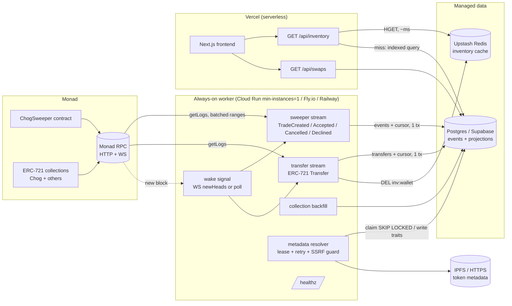

# ChogSweeper indexing and metadata pipeline

## Deployment diagram



Why a worker plus serverless API: a persistent RPC subscription and a 400 ms block loop cannot live in a
request-scoped function. Everything on the read path is stateless and scales to zero.

## Data flow

1. **Ingest.** Each stream pulls `getLogs` in ranges of at most `MAX_BLOCK_RANGE`, `CONFIRMATIONS` blocks behind head.
   A WebSocket `newHeads` subscription only *wakes* the loop sooner; polling always continues, so a dead socket
   costs latency, never correctness.
2. **Commit.** Raw events and the stream cursor are written in **one transaction**. A crash re-runs at most one batch.
3. **Project.** `swaps` and `swap_assets` are recomputed from `swap_events`; `nft_tokens.owner` is derived from the
   latest row in `nft_transfers`. Projections are pure functions of events.
4. **Invalidate.** After commit, the transfer stream deletes `inv:<wallet>` for every wallet in the batch.
5. **Resolve.** The metadata worker leases pending tokens, reads `tokenURI`, fetches JSON, stores name, normalised
   image URL and attributes, and indexes traits in `nft_traits`.
6. **Serve.** `/api/inventory` is one Redis `HGET` on a hit; on a miss it is one indexed query and a pipelined
   `HSET` + `EXPIRE`.

## Reliability

| Concern | Mechanism |
| --- | --- |
| Duplicate delivery / restart | Primary key `(tx_hash, log_index)` + `ON CONFLICT DO NOTHING`; projections recomputed, so replays are no-ops |
| Crash mid-batch | Cursor advances in the same transaction as the data |
| Reorg | Cursor stores the block hash. On mismatch: rewind `REWIND_DEPTH` blocks, delete events and transfers at or above it, recompute projections, replay |
| RPC failure | viem retries per request, `fallback` across `RPC_URLS`, then the supervisor restarts the stream with exponential backoff and full jitter (reset after 60 s healthy) |
| WebSocket drop | viem socket reconnect, plus a watchdog that resubscribes after 30 s of silence, plus polling as the floor |
| Redis outage | Cache errors are swallowed on both read and invalidate; the API falls back to Postgres |
| Poison metadata | Per-token attempts with exponential retry schedule (1, 2, 4 ... 60 min), capped at 6; never blocks other tokens |
| Shutdown | `SIGTERM` aborts loops between batches; Docker `HEALTHCHECK` reads `/healthz` (503 if a stream is stale > 60 s) |

## Latency budget for `/api/inventory` (target < 150 ms)

Hit path: Vercel function (warm) + one Upstash REST round trip in the same region, typically 10-40 ms.
Miss path: one query on `nft_tokens_owner_idx` (partial index on `owner`) plus a join to collections, typically
under 20 ms at this scale. Keep Vercel, Supabase and Upstash in the same region. Use the Supabase **transaction
pooler** URL for `DATABASE_URL` so serverless instances share connections. Responses also carry
`s-maxage=5, stale-while-revalidate=30` so Vercel's CDN absorbs bursts. The `Server-Timing` and `X-Cache`
headers expose the real numbers.

## API contract

### `GET /api/inventory?address={wallet}&collection={0x…|chog}`
`collection` is optional. Response:
```json
{ "address": "0x…", "collection": null, "count": 1,
  "items": [{ "contract": "0x…", "tokenId": "9", "name": "Chog #9", "collectionName": "Chog",
              "image": "https://…", "isChog": true, "traits": [{ "trait_type": "Hat", "value": "Red" }] }] }
```
Chog items come first. Capped at 500 items. `400` on bad input, `503` if Postgres is unavailable.

### `GET /api/swaps?user={wallet}&type=incoming|outgoing|history[&limit=50][&cursor={swapId}]`
- `incoming`: open swaps addressed to the user and not yet expired.
- `outgoing`: the user's open swaps, including expired ones (status `expired`), because the maker must cancel to reclaim assets.
- `history`: the user's `completed`, `cancelled` and `declined` swaps.

Swaps carry resolved asset names and images. Open swaps with no designated taker are not "incoming" for anyone.
Response: `{ "swaps": [...], "nextCursor": "12" | null }`, newest first.

## Operations

- **Run**: `cp indexer/.env.example .env`, set `SWEEPER_ADDRESS` and `SWEEPER_DEPLOY_BLOCK`, then `docker compose up --build`.
- **Add a collection**: add `address:startBlock` to `COLLECTIONS` and restart. It is registered, backfilled from
  `startBlock` in the background, and then followed live. Use the collection's deploy block as `startBlock`.
- **Cron / serverless fallback**: `node dist/main.js --once` catches up and exits (Cloud Run Job, GitHub Actions,
  Vercel Cron via a container). It gives minute-level freshness instead of sub-second.
- **Scale**: one active indexer process should own each event stream. The metadata queue uses `FOR UPDATE SKIP LOCKED`,
  but the current process starts metadata and both event streams together, so it does not support metadata-only replicas.
  Increase `METADATA_CONCURRENCY` for a larger metadata backlog; separate worker roles before scaling metadata independently.
- **Retention**: `nft_transfers` grows with chain activity. Rows older than the finality window can be pruned for
  tokens that have a later transfer; ownership only needs the newest row per token.

## Known limits

- Ownership indexing covers only registered collections (it does not discover arbitrary contracts).
- `tokenURI` fetching rejects private and reserved IPs, then pins the validated DNS result to the outbound socket on
  each request and redirect. Keep the worker isolated from internal services as defense in depth.
- Images are referenced by normalised URL, not re-hosted. Put an image CDN/proxy in front if gateways are slow.
- The Next.js API rate-limits its outbound-fetching and list endpoints (Redis when configured, per-instance memory otherwise). The limit keys on `x-forwarded-for`, so deploy behind a proxy that sets it (e.g. Vercel).
- Not exercised against a live Monad RPC or a running Docker daemon yet (see the test summary).


## NFT metadata and image resolution (what to know when an image does not show)

Pipeline: `tokenURI(id)` (or `uri(id)` for ERC-1155 style contracts) with a 6 s timeout and 2 retries on transient errors only,
then the metadata JSON over `ipfs://` / `ar://` / `data:` / `http(s)`, then the image.

* **Public IPFS gateways are unreliable.** `ipfs.io`, `dweb.link`, `w3s.link` and `nftstorage.link` currently return
  `429 "switching to a service worker gateway only"` to ordinary HTTP clients. Pinata and 4everland still serve. The resolver
  tries gateways healthiest-first, hedges a slow one with the next, rejects a `200` that is an HTML notice, and demotes
  gateways that refuse it. **For production set `IPFS_GATEWAYS` to a dedicated gateway first**; it is the single biggest
  reliability lever.
* **Images load through `/api/nft/image?url=`** for `ipfs://` and `ar://` (and plain `http://`, which browsers block as mixed
  content). The proxy streams, never buffers, accepts only real images (type allowlist plus byte sniffing), caps size at 12 MB,
  re-checks every redirect hop against the SSRF guard, and sets immutable cache headers for content-addressed data. Cold
  fetches can take 10+ s; the UI waits up to 25 s on the proxy before falling back.
* **`next/image` optimizer stays off** (`images.unoptimized`), although `remotePatterns` allows any host: a wildcard with the
  optimizer on would be an open image-resizing relay.
* **Chain reads must not assume Multicall3.** `safeMulticall` batches when it can and reads individually when the chain has no
  Multicall3 (or every call in the batch fails). Do not enable viem's automatic `batch.multicall`.
* **Do not use `instanceof` on viem errors in server code.** A bundled Next server can load two copies of viem; classify by error
  name/message instead (see `isDeterministicFailure`).
* Tokens that are not ERC-721 (`uri(id)` only) resolve for display but are flagged `tradeable: false`.


## Site structure and routing

| Route | What | Notes |
| --- | --- | --- |
| `/` | Landing page: hero, Why ChogSweeper, How it works, the tools in the Launchpad, Ecosystem & verified collections, full footer | No trading UI. Its call to action is **Open Launchpad** -> `/launchpad`. |
| `/launchpad` | Every tool in one workspace: Overview, New Swap, Requests, History, Public Trades, Collections, Activity, Token Lookup, and the trade detail modal | Slim footer only. `/swap` redirects here. |
| `/launchpad?tab=requests` | Same workspace, opened on a view | `tab` is `overview` (default, omitted), `new`, `requests`, `history`, `public`, `collections`, `activity` or `lookup`; `mode=open` selects a Public Open Trade. |
| `/#how-it-works` | The landing section, reachable from the navbar on any route | `scroll-mt` clears the sticky header. |

* **View state is URL state** (`lib/routes.ts`): links, reloads and shared URLs land on the same view. Tab changes use
  `history.replaceState` (instant, no extra history entries); unknown values fall back to the default view.
* **One navbar for the site** (`components/Navbar.tsx`): Swap, Requests (with the unread badge), How It Works, Contract
  Explorer (external). The right side shows the live network pill and a route-aware CTA: **Launch App** on the landing
  page, the wallet button inside the app. It uses `useSearchParams`, so it sits in a `Suspense` boundary in `app/layout.tsx`.
* **Unread requests** (`components/UnreadContext.tsx`) is provided at the root so the badge is right on every route; only the
  Requests view marks offers as read.
* The trading code (wagmi hooks, builder, image proxy, verified registry) only loads on `/launchpad`: the landing page ships
  ~124 kB of JS against ~244 kB for the app.
* Fonts are self-hosted from npm (`@fontsource-variable/*`), so builds and dev servers work offline and visitors make no
  request to Google.


## Trust model and known limits of the escrow

The contract guarantees that a trade settles atomically on its stated terms and that the owner can never change an
existing trade. It cannot guarantee that a token behaves like a real NFT.

* **Fake or hostile collections.** A hostile ERC-721 can answer `ownerOf` honestly at deposit and then do nothing on
  `transferFrom` at settlement, so a taker who pays MON would receive nothing. The contract therefore only allows collections
  on its verified list. The risk that remains is a collection the owner verifies by mistake, so add collections only after
  checking their code. The UI still asks a taker to confirm when a trade shows a collection the registry does not know.
* **Fee exemption for Chog holders** only looks at the maker's balance at the moment of creation. On testnet `MockChog.mint`
  is open to everyone, so the exemption is trivially obtainable there. On mainnet, anyone who can borrow or cheaply buy a Chog
  for one transaction can skip the fee. Treat the exemption as a courtesy, not as access control. The optional partner
  collection gives 25% off per token held (up to four) under the same caveat.
* **Expired trades hold their escrow** until the maker calls `cancelSwap`. Nothing is returned automatically. The UI says so
  on expired offers and offers a "Reclaim assets" action. The maker's fee comes back with it.
* **Open Counter trades can be taken by anyone**, including bots watching the public feed. An open offer with a low or zero
  ask will be taken by whoever lands first.
* **The maker pays the fee** (FoxySwap model): flat, paid when creating the swap on top of any MON escrowed, refunded in full
  if the swap is cancelled or declined, and kept only when it is accepted. The taker pays exactly `wantedMon` and never a fee.
  Because the fee is locked in per trade, later fee changes never affect existing trades.
* **Only verified collections can be traded.** The owner-managed list in the contract is enforced on both sides of every
  trade, so a hostile token contract cannot take a taker's payment and deliver nothing. A collection removed from the list
  never traps a trade that already holds its tokens: it can still settle or be cancelled. The list is separate from the
  indexer's registry; keep them aligned (`VERIFIED_COLLECTIONS` at deploy time, `setVerifiedCollections` afterwards).
* No ERC-1155, no ERC-2981 royalties, no "any token of a collection" offers: wanted tokens are specific (contract, id) pairs.
